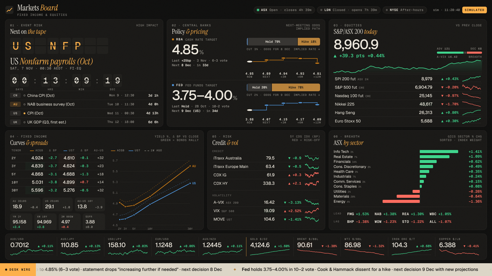
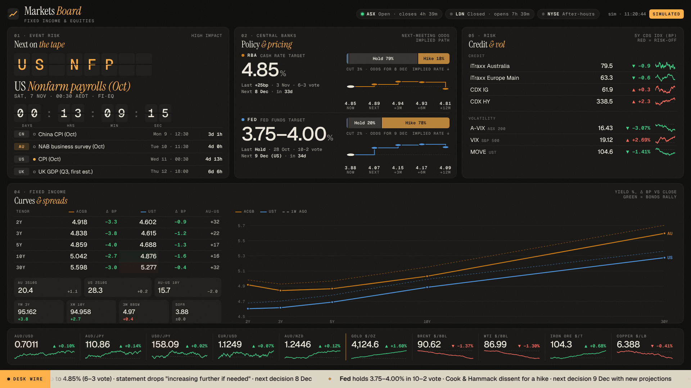
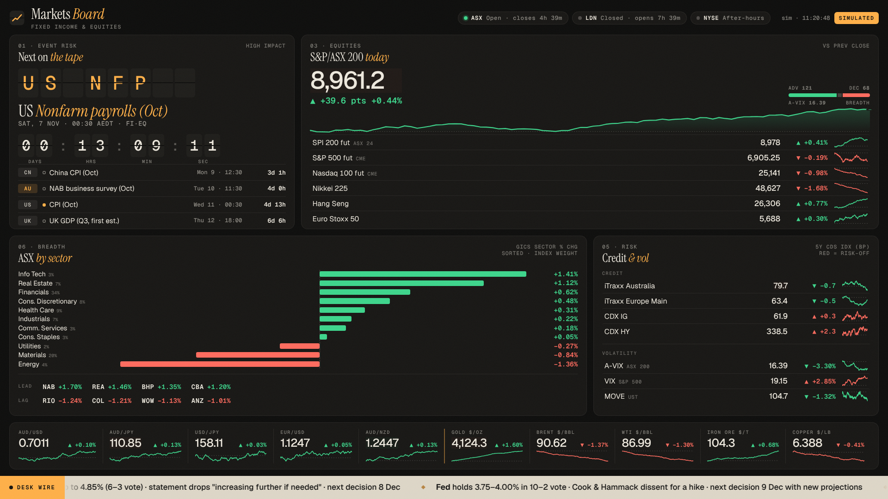

# market-tv

A trading-floor TV dashboard for **Fixed Income & Equities** desks. It's a single self-contained `index.html` with no build step and no dependencies, and the fonts are embedded, so it runs on locked-down floor networks.



> **Data is simulated until you connect a feed.** A `SIMULATED` badge stays in the header and switches to `LIVE` on the first real tick.

## Run it

Open `index.html` in the TV's browser and press **F** for fullscreen. You can also enable GitHub Pages (Settings → Pages → `main` / root) and point the TV at the Pages URL.

It scales from 1080p to 4K (16px → 32px base). Below 1180px wide it reflows into a scrolling page for laptops and phones.

## Panels

| # | Panel | What's on it |
|---|-------|--------------|
| 01 | **Next on the tape** | Split-flap countdown to the next high-impact release, followed by the next four events (AEDT) |
| 02 | **Policy & pricing** | RBA & Fed: current rate, last move and vote, cut/hold/hike odds for the next meeting, implied path |
| 03 | **S&P/ASX 200** | Index, intraday chart vs prior close, breadth, A-VIX, SPI / ES / NQ / Nikkei / HSI / SX5E |
| 04 | **Curves & spreads** | ACGB & UST 2/3/5/10/30Y with Δbp, AU–US spreads, curve vs 1W ago, 3s10s / 2s10s, YM / XM, 3M BBSW, SOFR |
| 05 | **Credit & vol** | iTraxx Australia / Europe, CDX IG / HY, A-VIX, VIX, MOVE |
| 06 | **ASX by sector** | Sorted diverging bars for GICS sectors plus ASX 20 leaders and laggards |
| — | FX & commodities strip | AUD/USD, AUD/JPY, USD/JPY, EUR/USD, AUD/NZD, gold, Brent, WTI, iron ore, copper |
| — | Desk wire | Scrolling headlines / desk notes |

The header shows market **session status** (ASX / LDN / NYSE open, pre-open, closing auction, time to the next transition). It deliberately has no world clock.

## URL options

| Param | Effect |
|-------|--------|
| `?view=fi` / `?view=eq` / `?view=all` | Layout preset per desk (press **V** to cycle) |
| `?desk=Sydney%20Markets` | Desk name in the header |
| `?cvd=1` | Colour-blind-safe up/down (blue / orange) |
| `?yield=sign` | Colour yield changes by sign. The default is the bond-price convention: yield down = green |

Colour convention: green = good for longs. Falling yields show green (bonds rally). Wider credit and higher vol show red (risk-off). Every move also carries an arrow and a sign, so colour is never the only signal.

| Fixed income view | Equities view |
|---|---|
|  |  |

## Wiring real data

Everything binds through a small global API:

```js
Board.tick('AU10Y', 5.012);            // last price/yield (optional 3rd arg: prev close)
Board.tick('XJO', 8971.3, 8921.6);
Board.policy('RBA', { probs: { cut: 2, hold: 80, hike: 18 }, path: [4.85, 4.88, 4.92, 4.90, 4.80] });
Board.sector('Financials', 0.74);
Board.wire(['<b>RBA</b> minutes due Tuesday 11:30', '...']);
Board.events([{ t: '2026-11-10T13:30Z', c: 'US', code: 'US CPI', name: 'CPI (Oct)', imp: 'high', desk: 'FI·EQ' }]);
```

Or set `CONFIG.feedUrl` to a WebSocket that sends `{"s":"AU10Y","p":5.012,"pc":5.069}` (single objects or arrays). It reconnects automatically.

Symbols are the keys of `SEED` in the script (`XJO`, `AP1`, `ES1`, `NQ1`, `NKY`, `HSI`, `SX5E`, `AU2Y…AU30Y`, `US2Y…US30Y`, `BBSW3`, `SOFR`, `ITXAU`, `ITXEU`, `CDXIG`, `CDXHY`, `AVIX`, `VIX`, `MOVE`, `AUDUSD`, `AUDJPY`, `USDJPY`, `EURUSD`, `AUDNZD`, `GOLD`, `BRENT`, `WTI`, `IRON`, `COPPER`).

In live mode, a row greys out if its last tick is older than `CONFIG.staleAfterSec` (default 15s), and the header shows time since the last tick.

## TV housekeeping

- **Burn-in protection:** the board orbits by 1–2px every `pixelShiftSec` (120s).
- **Self-healing:** a full reload runs every `reloadEveryHours` (6h).
- **Cursor** hides after 3s idle. `prefers-reduced-motion` disables all animation.

## Before going live, check

- RBA/Fed next-meeting odds and implied paths are **placeholders**. Feed them from ASX RBA Rate Tracker / CME FedWatch or your own curve.
- The event calendar is hand-entered (`CONFIG.events`, UTC). It covers 6 Nov – 10 Dec 2026. The NAB survey time (11:30 AEDT) is assumed.
- The wire headlines are a snapshot of 3–5 Nov 2026 news. Replace them with desk notes or a news feed.
